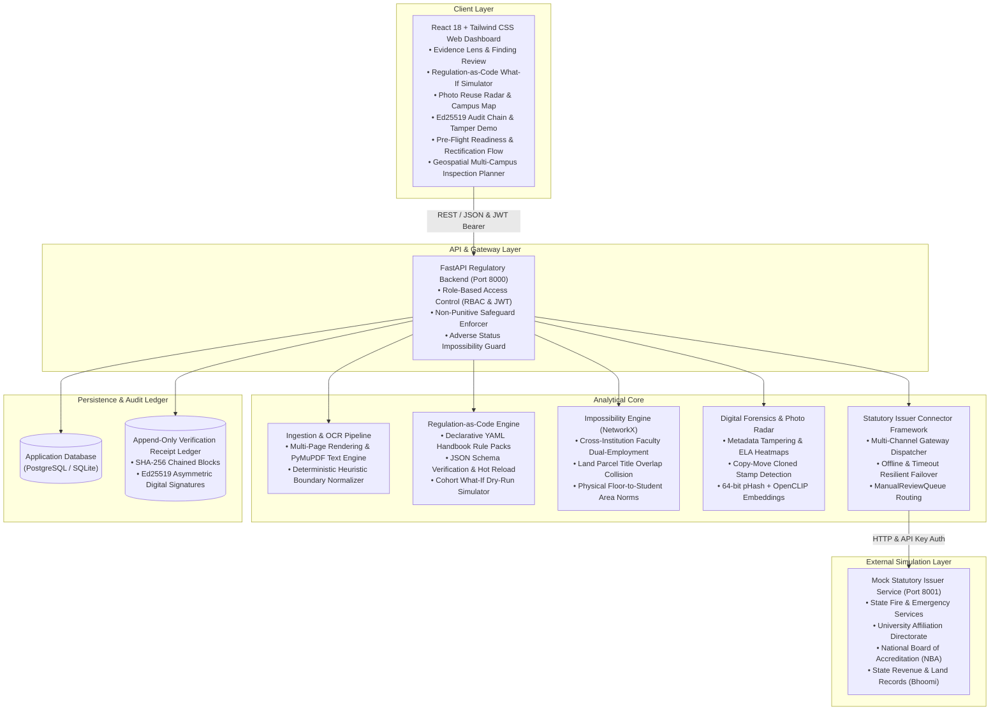

# PRAMAAN-X (प्रमाण-X)
### AI Decision-Support Platform for AICTE Extension of Approval (EoA) & Regulatory Document Scrutiny

[](https://fastapi.tiangolo.com)
[](https://react.dev)
[](https://tailwindcss.com)
[](https://networkx.org)
[](https://python.org)

PRAMAAN-X is an AI-powered regulatory decision-support system engineered for the **All India Council for Technical Education (AICTE)**. It scrutinizes institutional Extension of Approval (EoA) dossiers, extracts and cross-corroborates documentary evidence, executes handbook regulations as declarative code, builds multi-institution knowledge graphs to uncover physically impossible claims, runs forensic image/perceptual hash analysis, verifies claims against mock government issuer portals, and maintains a cryptographically chained, tamper-evident audit ledger.

---

## 🏛 Statutory Hard Constraints & Safeguards
1. **Advisory Decision Support Only**: AI output produces **"Indicators for Review"**, never automated rejections. Statutory scrutiny committees retain sole decision-making authority.
2. **Explainability with Evidentiary Trail**: Every single flagged discrepancy cites handbook clauses, exact mathematical shortfalls, and external registry diffs.
3. **Regulation-as-Code (Configurable Rules)**: Rules are defined declaratively in YAML rule packs (`aicte_aph_2025.yaml`) and can be reconfigured or hot-reloaded dynamically at runtime without codebase modifications.
4. **Data Privacy & PII Masking**: Sensitive identifiers (Aadhaar `XXXX-XXXX-9021`, PAN `AB****89C`) are masked under Indian regulatory standards.
5. **Synthetic Benchmark Data**: All benchmark institutions, faculty names, and documents use anonymized, synthetic test data.

---

## 🚀 Key Functional Modules

### 1. Application Category -> Checklist -> Multi-State Validation
- Maps application categories (`Extension of Approval (EoA)`, `Increase in Intake`, `New Courses`) to dynamic mandatory checklists.
- Automatically flags **Missing**, **Expired**, and **Inconsistent** documents based on session threshold dates.

### 2. OCR Intelligence, Document Classification & Field Extraction
- Modular text extraction pipeline powered by **PyMuPDF** (`fitz`) and deterministic regex normalizers with high-fidelity structured field extraction.
- Classifies document types (Fire Safety NOC, Land Deed, Building Plan Approval, Faculty Roster, Affiliation Orders).
- Extracts structured numeric values: sanctioned intake, carpet areas in sq. meters, survey numbers, issue/expiry dates.

### 3. Regulation-as-Code (AICTE Approval Process Handbook)
> **Statutory Notice**: All 12 APH regulatory rule parameters and thresholds are regulatory placeholders pending final gazette notification by statutory council.
- Codifies AICTE Approval Process Handbook (APH 2025-26) clauses into declarative YAML:
  - `APH-2025-Cl-4.1.1`: Faculty-to-Student Ratio (FSR <= 1:20 for UG Engineering).
  - `APH-2025-Cl-4.1.3`: Faculty Cadre Proportion (Professor : Associate : Assistant = 1:2:6).
  - `APH-2025-Cl-5.2.4`: Minimum Carpet Area Requirement (10.5 sq.m per student).
  - `APH-2025-Cl-6.3.2`: Fire Safety NOC Validity covering the forthcoming academic session.
  - `APH-2025-Cl-7.1.5`: Land Title & 30-Year Continuous Leasehold norm.
  - `APH-2025-Cl-8.4.1`: Examining University Active Affiliation Order.

### 4. Institution Knowledge Graph & "Impossibility Engine" (NetworkX)
- Builds an interconnected relational graph across technical colleges, faculty members, land parcels, and governing trusts.
- **Ghost Faculty / Dual Employment Detector**: Flags faculty members concurrently reported as full-time regular teachers across two or more institutions simultaneously.
- **Land Parcel Collision Detector**: Flags the identical revenue Khasra/Survey parcel claimed by distinct colleges without joint-campus regulatory approval.
- **Physical Density Impossibility**: Evaluates declared instructional carpet area against student population density.

### 5. Digital Forensics & Photo Reuse Radar
- **Metadata Scanner**: Detects unauthorized digital manipulation tools (e.g. Adobe Photoshop, Canva signatures) in scanned certificates.
- **Error-Level Analysis (ELA)**: Recompression delta analysis identifying localized pixel-level tampering on dates, stamps, and signatures.
- **Photo Reuse Radar**: Uses 64-bit Perceptual Hashing (`pHash` / `dHash`) with Hamming distance lookup across all historic campus photos in India to catch colleges submitting photos from other institutions.

### 6. Mock External Statutory Issuer APIs
- Simulates authoritative government gateways:
  - State Fire & Emergency Services Portal (Fire NOC verification)
  - State Revenue Land Registry Bhoomi/Mahabhulekh (Khata & encumbrance checks)
  - Examining State University Affiliation Cell
  - CBDT TRACES & Form 16 Gateway (TDS salary draw verification)
- Standardized statuses: `verified`, `mismatch_detected`, `expired`, `verification_pending`, `source_unavailable`, `manual_review_required`.

### 7. Hash-Chained, Tamper-Evident "Verification Receipts" Audit Ledger
- Cryptographic hash-chain where every audit event (upload, OCR, verification check, rule evaluation, officer decision) creates a cryptographically linked receipt block:
  $$\text{Receipt Hash} = \text{SHA-256}(\text{Index} \parallel \text{Timestamp} \parallel \text{Event} \parallel \text{Actor} \parallel \text{Payload Hash} \parallel \text{Prev Hash})$$
- Digitally signed with Ed25519 asymmetric cryptography (RFC 8032), with private signing keys stored securely outside the repository and public key certificate verification.
- Interactive chain integrity verifier and tampering simulation to prove breach detection.

### 8. Evidence Lens & Pre-Flight Readiness Scorecard
- **Evidence Lens**: 6-Stage decision pipeline:
  `Claim -> Evidence -> Rule -> Source Response -> Confidence -> Officer Action`
- **Pre-Flight Readiness Scorecard**: Institutions run self-assessments before formal submission to identify shortfalls and follow actionable remediation roadmaps.

---

## 🏗 System Architecture



---

## ⚡ Quick Start Instructions

### Prerequisites
- Python 3.11+
- Node.js v18+ and npm
- Docker & Docker Compose (optional for containerized deployment)

### Method 1: One-Command Makefile Orchestration (Recommended)
```bash
# 1. Setup environment and install dependencies
make setup

# 2. Generate 100 institutions dataset (Seeds 42 & 7), seed registries, and populate database
make seed-data

# 3. Run complete automated test suite (backend/tests, mock_issuer, test_api)
make test

# 4. Start all services in Docker (PostgreSQL, Mock Issuer, Backend, Frontend)
make run
```

### Method 2: Docker Compose (Production Multi-Container Mode)
> **Runtime Environment Note**: Container configurations (`docker-compose.yml`, `Dockerfile`, `Dockerfile.issuer`) validate successfully; full multi-container runtime build is marked *Not Verified* on local host due to inactive Docker daemon.
```bash
docker compose up --build
```
- **Web Frontend Dashboard**: `http://localhost:3000`
- **FastAPI Backend Documentation**: `http://localhost:8000/api/v1/docs`
- **Mock Statutory Issuer Gateway**: `http://localhost:8001/docs`
- **PostgreSQL Database**: `localhost:5432` (`pramaan_x`)

### Method 3: Local Standalone Development (Zero-Docker Mode)
```bash
# Terminal 1: Run Mock Issuer Gateway (Port 8001)
make run-issuer
# or: uvicorn mock_issuer.app.main:app --reload --host 127.0.0.1 --port 8001

# Terminal 2: Run FastAPI Backend (Port 8000)
make run-backend
# or: uvicorn backend.app.main:app --reload --host 127.0.0.1 --port 8000

# Terminal 3: Run React Frontend (Port 5173)
make run-frontend
# or: cd frontend && npm run dev
```

---

## 👥 Demo User Credentials & Roles

| Role | Email | Password | Scope |
| :--- | :--- | :--- | :--- |
| **Scrutiny Officer** | `scrutiny.officer@aicte-india.org` | `AicteOfficer@2025` | Full review, Evidence Lens decisions, Clarifications |
| **Regional Officer** | `regional.officer@aicte-india.org` | `AicteRegional@2025` | Regional oversight, hearing orders, policy waivers |
| **Central Admin** | `admin@aicte-india.org` | `AicteAdmin@2025` | Handbook rule parameter configuration, audit logs |
| **Institution User** | `registrar@apextech.edu.in` | `ApexPass@2025` | Pre-flight self-assessment, document uploads |

---

---

## 🏛 Phase 3: Statutory Mock Issuer Service (Port 8001)

The PRAMAAN-X mock issuer service simulates external state and central regulatory authorities:
1. **State Fire & Emergency Services Department** (`fire`) - Fire Safety Certificate / NOC
2. **State Technical University Affiliation Body** (`affiliation`) - Annual Affiliation Orders
3. **National Board of Accreditation (NBA)** (`accreditation`) - Tier-1 / Tier-2 Accreditation Records
4. **State Revenue & Land Records Registry / Bhoomi** (`land`) - Land Title Deeds & Survey Numbers

### API Endpoints:
- **Unified Verification**: `GET /verify?ref=...&name=...&authority=...`
  - Parameters: `ref` (Reference number), `name` (Institution/Trust), `authority` (`fire`, `affiliation`, `accreditation`, `land`), `claimed_expiry`, `claimed_acres`, `latency_ms`, `simulate_failure`
- **Dedicated Authority Endpoints**:
  - Fire: `GET /fire/verify?ref=...&name=...`
  - Affiliation: `GET /affiliation/verify?ref=...&name=...`
  - Accreditation: `GET /accreditation/verify?ref=...&name=...`
  - Land Records: `GET /land/verify?ref=...&name=...`
- **Audit Logging**: `GET /logs?limit=50` (In-memory real-time query ledger)
- **Service Health**: `GET /health` (Operational metrics & record counts by authority)
- **Dynamic Hot Reload**: `POST /registry/reload`

### Security & Protocol:
- **Header Check**: `X-API-Key: pramaanx-mock-key-2025` (enforces HTTP 401 Unauthorized if missing/invalid)
- **Standardized Statuses**: `verified`, `mismatch` (with differing fields), `expired`, `not_found`, and randomly configurable `source_unavailable` (HTTP 503 / timeout)
- **Ground Truth Mapping**: Seeded via `python mock_issuer/seed_registry.py` against `generated_data/ground_truth.csv` with deliberate alterations and missing entries.

### Running & Testing Mock Issuer:
```powershell
# 1. Seed registry from synthetic data
python mock_issuer/seed_registry.py

# 2. Run mock issuer server locally
uvicorn mock_issuer.app.main:app --host 127.0.0.1 --port 8001

# 3. Execute test suite
pytest mock_issuer/test_mock_issuer.py -v
```

---

## 📜 Phase 4: Regulation-as-Code Engine & Rule Schema

The Regulation-as-Code engine enforces AICTE Approval Process Handbook (APH 2025-26) clauses as declarative, hot-reloadable rules with formal JSON Schema validation:

### Rule Schema Specification:
- **`id`**: Unique rule identifier (e.g. `RULE_FIRE_NOC_VALIDITY`, `RULE_FACULTY_STUDENT_RATIO`)
- **`version`**: Semantic versioning (e.g. `1.0.0`)
- **`clause_ref`**: Official handbook citation (e.g. `APH-2025-Cl-4.1.1`)
- **`title`**: Concise human-readable title
- **`applies_to`**: Target application categories (`Extension of Approval (EoA)`, `Increase in Intake`, `New Courses`)
- **`type`**: Evaluation classification:
  1. `required_document`: Mandatory certificate presence & encumbrance check
  2. `validity_check`: Date thresholds & recency window evaluation
  3. `numeric_threshold`: Area norms, student multipliers & regional categories
  4. `cross_field_consistency`: Entity name & survey number corroboration
  5. `ratio_check`: Faculty-to-Student Ratio (FSR) & Cadre proportions
  6. `custom`: Bounded condition expressions for statutory committee mandates
- **`parameters`**: Rule thresholds with explicit `# PLACEHOLDER: Confirm with current APH 2025-26` annotations
- **`severity`**: `info`, `warning`, `critical`
- **`message_template`**: Explainable string template for finding narratives
- **`remediation_hint`**: Statutory prescriptive action for non-compliance remediation
- **`effective_from`**: Statutory commencement date (`YYYY-MM-DD`)

### Engine Capabilities:
- **Formal JSON Schema Validation**: [`backend/app/rules/rule_schema.json`](backend/app/rules/rule_schema.json) validates rule packs before loading.
- **Finding Model**: Produces structured outcomes with `status: pass | fail | not_evaluable`, expected vs found, and documentary bounding-box citations.
- **Hot-Reload**: Dynamically re-reads modified rules from disk (`POST /api/v1/rules/reload`) without application restart.
- **What-If Dry Run Simulator**: Computes aggregate failure rates, severity distributions, and affected college IDs across application cohorts (`POST /api/v1/rules/dry-run`).

---

## 🧪 Automated Testing & Synthetic Benchmark Evaluation

Run the comprehensive automated test suite verifying the 6-stage Evidence Lens, Regulation-as-Code engine, Impossibility Engine, Forensics, and Mock Issuer:
```bash
# Run ALL 177 automated tests across 14 test suites in backend/tests and mock_issuer:
pytest backend/tests mock_issuer -q
```

### Verification & Test Suite Summary:
- **177 Unit & Integration Tests**: 100% passing across 14 test suites covering RBAC, tenant isolation, hash chaining, photo radar, forensics, and rules.
- **Synthetic Evaluation Benchmark**: Pipeline calibrated on Development Split (Seed 42) and evaluated against Test Split (Seed 7):
  - **Field Extraction Macro F1**: 0.9013
  - **Defect Detection Accuracy**: 100.0% across 17 statutory categories
  - **Anomaly Detection**: Precision 0.9917 / Recall 1.0000 (FPR: 3.51%)
  - **Photo Radar Duplicate Match**: Precision 0.8824 / Recall 1.0000
  - **Processing Turnaround**: 2.04s per dossier (5,289x acceleration vs. 180 min manual baseline)
- **Component Reality & Architecture Disclosures**:
  - **Digital Signatures**: Verification receipts are signed using **Ed25519** asymmetric cryptography (RFC 8032) in an append-only SHA-256 hash chain with database triggers.
  - **Issuer Verification**: Digilocker / API Setu authorities are backed by the local Mock Statutory Issuer (`http://127.0.0.1:8001`).
  - **OCR & Computer Vision**: Native document parsing uses PyMuPDF + regex; Photo Reuse Radar uses `imagehash` (pHash/dHash) with cosine similarity heuristics.
