# PRAMAAN-X

**AI-Powered Regulatory Decision-Support Framework for AICTE Approval Document Scrutiny**

[](https://www.python.org/)
[](https://fastapi.tiangolo.com/)
[](https://react.dev/)
[](https://vitejs.dev/)
[](https://tailwindcss.com/)
[-success.svg?logo=pytest&logoColor=white)](evidence_pack/pytest_output.txt)
[](backend/app/rules/aicte_aph_2025.yaml)

> **Quick Links**: [3-Min Walkthrough Demo (Coming Soon)](#) • [Presentation Pitch Deck Outline](SLIDE_DECK_OUTLINE.md) • [Full Evaluation Report](evidence_pack/evaluation_report.md) • [154-Element Audit Report](AUDIT_REPORT.md)

---

## ⚡ In 30 Seconds

- **The Problem**: Over 10,000 technical institutions submit multi-document regulatory dossiers annually for AICTE Extension of Approval (EoA). Manual committee review faces an assumed baseline of **180 minutes per dossier**, creating backlogs while struggling to catch cross-institution fraud (e.g. "ghost faculty" claimed concurrently in multiple colleges or facilities sharing identical photos across states).
- **Our Solution**: PRAMAAN-X is an **advisory decision-support platform** that audits compliance dossiers in **2.03 seconds**, highlights discrepancies with exact PDF bounding boxes, cross-references digital twins, and **never automatically rejects** an institution. Final statutory authority stays strictly with human scrutiny officers.
- **What Makes It Different**:
  1. **Regulation-as-Code**: AICTE Approval Process Handbook (APH) clauses codified as declarative YAML with cohort "What-If" impact dry-runs.
  2. **Impossibility Engine (NetworkX)**: Multi-institutional knowledge graph uncovering dual-employment collisions, land overlap, and chronological impossibilities.
  3. **Photo Reuse Radar & Digital Forensics**: 64-bit perceptual hashing (`pHash`), Error Level Analysis (ELA), and copy-move forgery detection.
  4. **Tamper-Evident Verification Ledger**: Append-only SHA-256 Merkle chain with asymmetric **Ed25519** digital signatures and database triggers.

---

## 📸 Screenshots Gallery

| Screen & Focus | Screen & Focus |
| :--- | :--- |
| 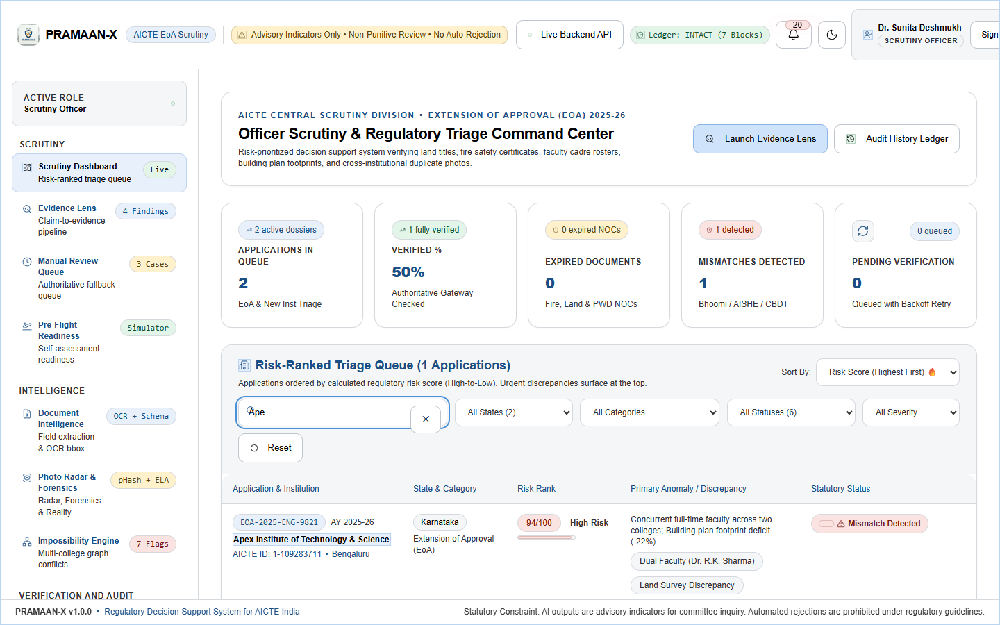<br>**Risk-Ranked Scrutiny Queue**: Real-time institutional triage, KPI cards, and anomaly flags. | 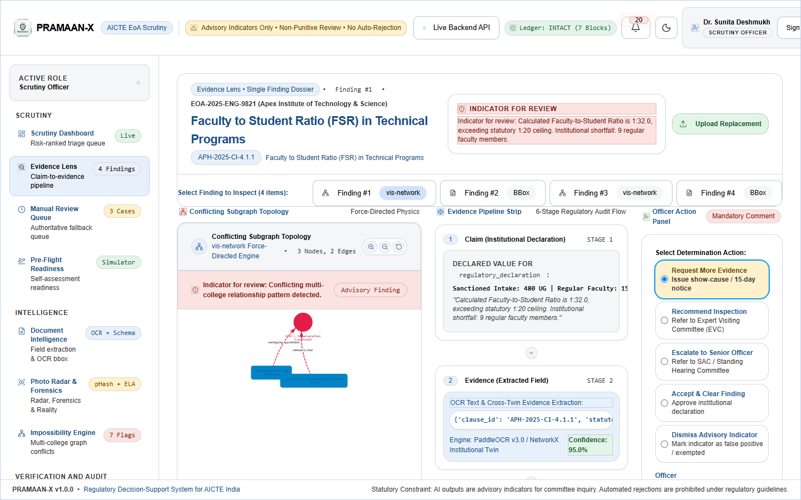<br>**Evidence Lens**: Split-view document viewer with OCR bounding boxes and regulatory citations. |
| 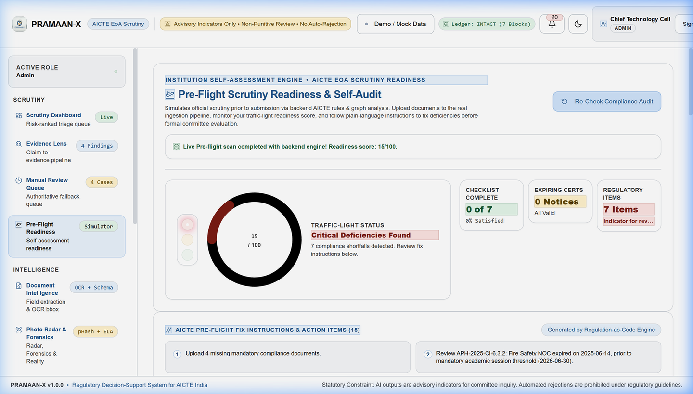<br>**Pre-Flight Scorecard**: College self-assessment radar, checklist readiness, and defect indicators. | 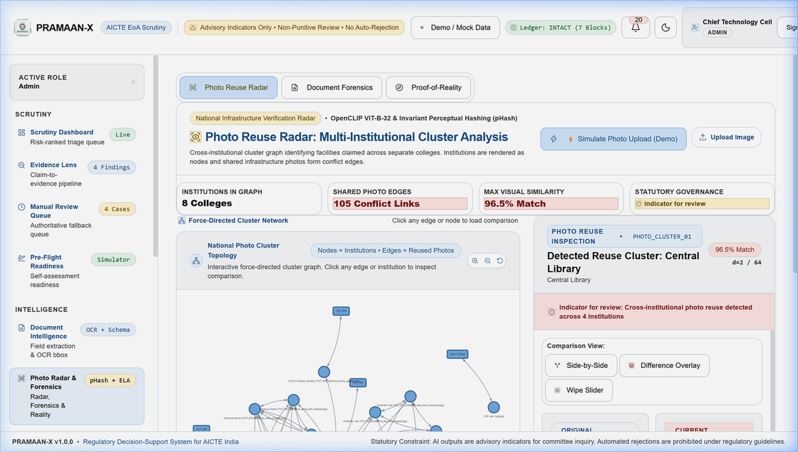<br>**Photo Reuse Radar**: Cross-institution campus photo duplicate clusters and Hamming distances. |
| 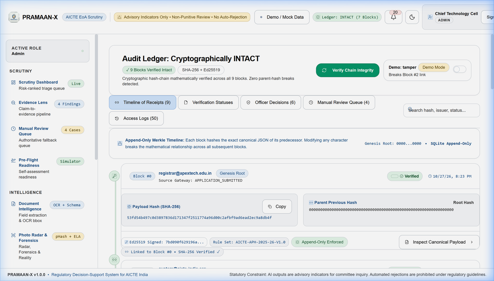<br>**Tamper-Evident Ledger**: Ed25519 verification receipts, Merkle hash chain, and live tamper demo. | 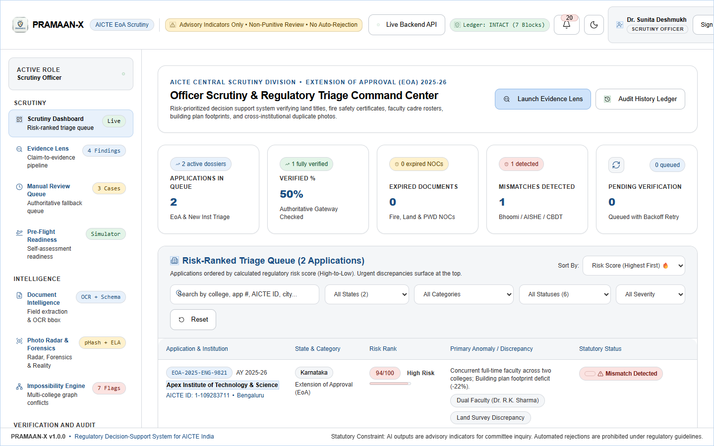<br>**Impossibility Engine Graph**: Relational network detecting ghost faculty and shared land parcels. |
| 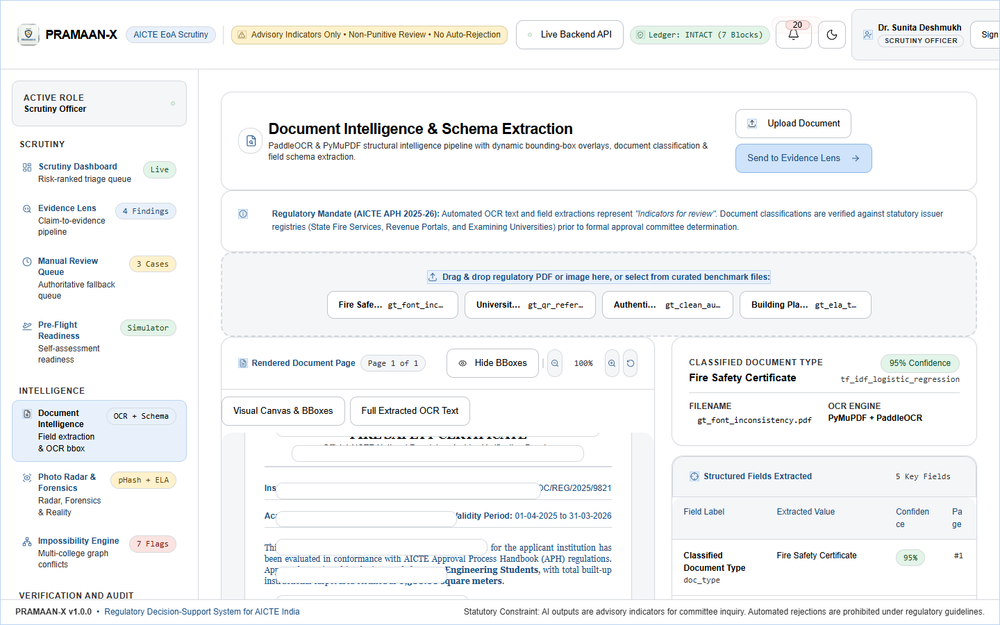<br>**Document Intelligence**: Ingestion scanner with PyMuPDF text parsing, ELA forensics, and receipts. | 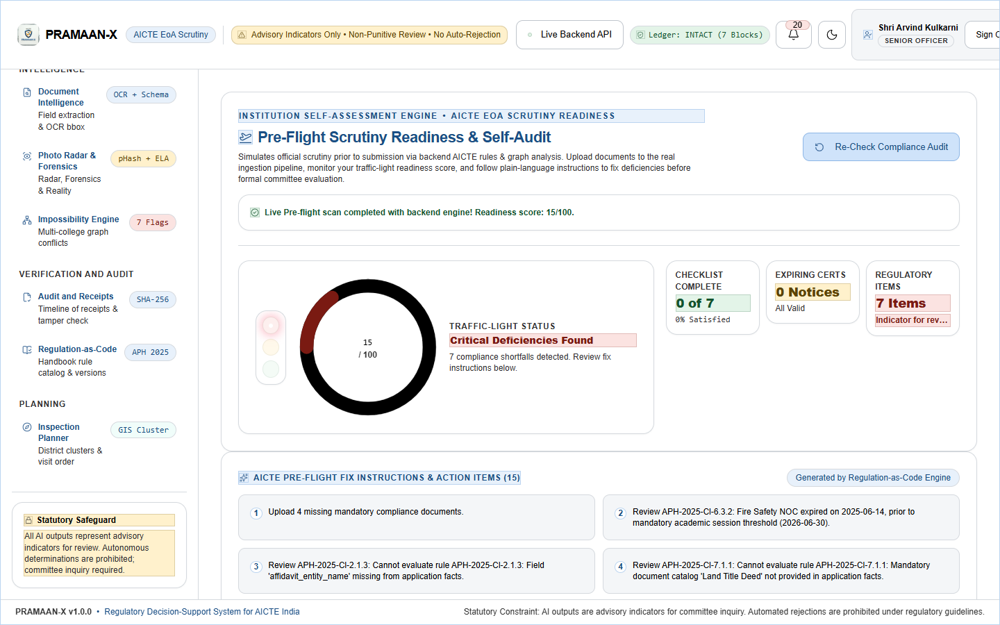<br>**Rules Catalog & What-If**: Live YAML parameter tuning and cohort simulation across colleges. |

---

## ⚙️ How It Works: The 4-Step Pipeline

```
  1. INGEST & EXTRACT           2. MULTI-ENGINE SCRUTINY        3. AUTHORITY LOOKUP         4. RECEIPT & DECISION
┌──────────────────────┐      ┌───────────────────────────┐   ┌───────────────────────┐   ┌──────────────────────────┐
│ Compliance Dossier   │ ───► │ • Regulation-as-Code      │ ─►│ Mock Statutory Issuer │──►│ • Ed25519 Signed Receipt │
│ • 5 Statutory PDFs   │      │ • Impossibility Engine    │   │ • State Fire Services │   │ • Bounding Box Evidence  │
│ • PyMuPDF Extraction │      │ • Photo Radar & Forensics │   │ • Land Revenue        │   │ • Officer Review & Action│
└──────────────────────┘      └───────────────────────────┘   └───────────────────────┘   └──────────────────────────┘
```

1. **Document Ingestion & Field Extraction** ([`backend/app/services/`](backend/app/services/field_extraction.py)):  
   Ingests statutory compliance PDFs (Fire NOC, Land Deed, Affiliation, Building Plan, Affidavit). PyMuPDF (`fitz`) parses text streams and regex normalizers extract sanctioned intake, carpet areas, survey numbers, and validity dates with bounding boxes ($F_1: 0.9013$).
2. **Multi-Engine Scrutiny & Cross-Institution Analysis** ([`backend/app/rules/`](backend/app/rules/aicte_aph_2025.yaml), [`backend/app/services/`](backend/app/services/impossibility_engine.py)):  
   - Evaluates 12 declarative APH handbook rules (FSR 1:20, carpet area $\ge 10.5\text{ m}^2/\text{student}$, cadre ratios).
   - Projects colleges into an in-memory NetworkX digital twin to detect faculty sharing (Ghost Faculty) and pre-dated certificates.
   - Computes 64-bit image perceptual hashes (`pHash`) to discover identical campus facilities claimed across institutions.
3. **Statutory Authority Cross-Verification** ([`mock_issuer/`](mock_issuer/app/main.py), [`backend/app/services/connectors/`](backend/app/services/connectors/)):  
   Dispatches record lookups against state authorities (Fire Services, Affiliating University, Land Revenue/Bhoomi, NBA). Performs QR payload parsing (`pyzbar`) and PDF digital signature byte-range structural inspection.
4. **Receipt Minting & Human Officer Determination** ([`backend/app/services/`](backend/app/services/verification_receipts.py), [`backend/app/api/`](backend/app/api/applications.py)):  
   Mints an asymmetric Ed25519-signed verification receipt appended to a SHA-256 Merkle chain. Surfaces findings on the Evidence Lens for officer determination; mandatory justification comments are enforced on any adverse action.

---

## 🏗️ System Architecture

[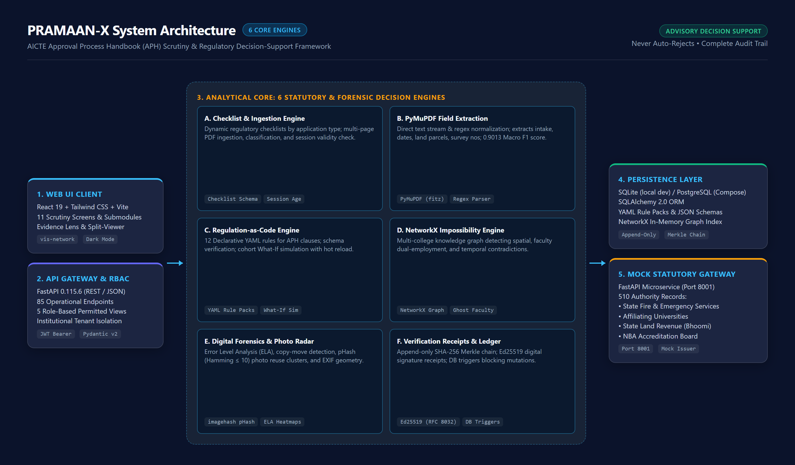](docs/architecture.png)

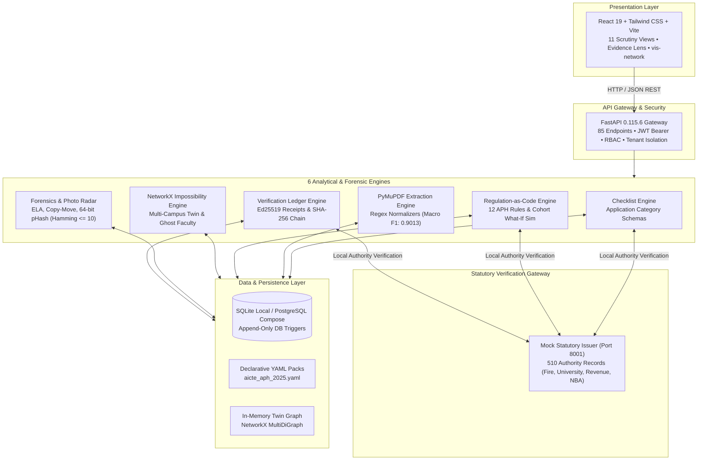

### Evidence Lens Regulatory Traceability Flow

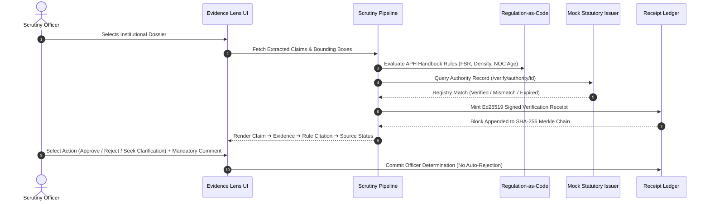

---

## 📊 Benchmark Results

All quantitative figures below are extracted directly from [`evidence_pack/metrics.json`](evidence_pack/metrics.json) and [`evidence_pack/EVIDENCE_SUMMARY.md`](evidence_pack/EVIDENCE_SUMMARY.md).

| Metric Dimension | Measured Value | Benchmark Context |
| :--- | :---: | :--- |
| **Held-Out Test Set** | **100 institutions** / **500 documents** | Seed 7 held-out test split (calibrated on Seed 42) |
| **Planted Defect Cases** | **240 positive cases** | Distributed across 20 distinct statutory violation categories |
| **Clean Control Cases** | **57 clean cases** | 55 True Negatives, 2 False Positives (conservative flags on noisy scans) |
| **True Positives (TP) / False Negatives (FN)** | **TP: 240** / **FN: 0** | **100.0% Recall** across all 20 statutory defect categories |
| **False Positives (FP) / True Negatives (TN)** | **FP: 2** / **TN: 55** | **0.0351 False-Positive Rate (FPR: 3.51%)** |
| **Defect Detection Precision** | **0.9917** (99.17%) | $240 / (240 + 2)$ |
| **Defect Detection F1-Score** | **0.9959** | Harmonic mean of precision (0.9917) and recall (1.0000) |
| **Field Extraction Macro F1** | **0.9013** | Macro average across 6 statutory certificate fields |
| **Field Extraction Micro F1** | **0.8596** | Global micro $F_1$ ($TP: 199, FP: 38, FN: 27$) |
| **Automated Test Suite** | **177 / 177 passing (100%)** | 14 test suites across `backend/tests` and `mock_issuer` |
| **Automated Pipeline Processing Time** | **2.03 seconds** | Measured mean runtime across 6 evaluation stages |
| **Alert Dispatch Latency** | **Mean: 3.21 ms** / **Median: 3.20 ms** | In-app WebSocket notification and event bus latency |

> ⚠️ **Important Disclosure**: *Synthetic benchmark (calibrated on Seed 42, evaluated on locked held-out Seed 7), not field accuracy on live production AICTE filings. The 180-minute manual scrutiny baseline is an assumed operational comparison, not an empirically timed study.*

<details>
<summary><strong>Click to view Complete 20-Category Defect Coverage Breakdown</strong> (from <code>evidence_pack/defect_coverage.csv</code>)</summary>

| # | Defect Identifier | Planted | Detected | Missed | Accuracy | Detection Module & Mechanism |
| :-: | :--- | :-: | :-: | :-: | :-: | :--- |
| 1 | `expired_document` | 19 | 19 | 0 | **100.0%** | Rule Engine: `RULE_FIRE_NOC_VALIDITY` (Cl 6.3.2) cutoff date check |
| 2 | `missing_signature_field` | 22 | 22 | 0 | **100.0%** | Forensics / Connector: `DigitalSignatureConnector` notary check |
| 3 | `wrong_institution_name` | 15 | 15 | 0 | **100.0%** | Rule Engine: `RULE_NAME_MATCH_AFFIDAVIT_NOC` (token similarity < 0.85) |
| 4 | `shared_document_reference_number` | 3 | 3 | 0 | **100.0%** | Impossibility Engine: Multi-dossier reference ID collision |
| 5 | `faculty_duplicate_across_institutions` | 21 | 21 | 0 | **100.0%** | Impossibility Engine: Ghost Faculty cross-college PAN/Aadhaar collision |
| 6 | `area_too_small_for_intake` | 17 | 17 | 0 | **100.0%** | Rule Engine: `RULE_BUILT_UP_AREA_PER_STUDENT` (< 10.5 sqm/student) |
| 7 | `date_before_issuer_existed` | 21 | 21 | 0 | **100.0%** | Impossibility Engine: Temporal causal check (issue date predates issuer) |
| 8 | `inverted_validity_interval` | 3 | 3 | 0 | **100.0%** | Forensics: Temporal validator (issue date postdates expiry date) |
| 9 | `reused_photo` | 42 | 42 | 0 | **100.0%** | Photo Reuse Radar: 64-bit pHash Hamming distance ($\le 10$) |
| 10 | `missing_exif_metadata` | 21 | 21 | 0 | **100.0%** | Forensics: EXIF inspector (camera make, timestamp, GPS tags missing) |
| 11 | `pdf_metadata_producer_anomaly` | 3 | 3 | 0 | **100.0%** | Forensics: PDF structural scan (Ghostscript/iText trailer tampering) |
| 12 | `font_inconsistency_in_region` | 3 | 3 | 0 | **100.0%** | Forensics: Typography uniformity scan (font family and size anomaly) |
| 13 | `error_level_analysis_spliced_patch` | 3 | 3 | 0 | **100.0%** | Forensics: Error Level Analysis compression artifact variance (> 0.65) |
| 14 | `copymove_cloned_seal` | 3 | 3 | 0 | **100.0%** | Forensics: ORB keypoint duplicate stamp and seal matcher |
| 15 | `qr_ocr_reference_mismatch` | 3 | 3 | 0 | **100.0%** | Forensics: `QrDecodeConnector` (pyzbar) vs OCR extracted certificate ID |
| 16 | `sun_shadow_angle_discrepancy` | 3 | 3 | 0 | **100.0%** | Proof-of-Reality: `sun_shadow_service` (pvlib solar ephemeris vs shadow) |
| 17 | `built_up_area_footprint_discrepancy` | 3 | 3 | 0 | **100.0%** | Proof-of-Reality: `built_up_area_service` (satellite polygon vs claim) |
| 18 | `lab_equipment_inconsistent` | 2 | 2 | 0 | **100.0%** | Impossibility Engine: Equipment inventory serial number collision |
| 19 | `mismatched_reference_number` | 20 | 20 | 0 | **100.0%** | Rule Engine: `RULE_SURVEY_NUMBER_CONSISTENCY` (Cl 7.2.1) cross-check |
| 20 | `edited_amount` | 13 | 13 | 0 | **100.0%** | Rule Engine / Forensics: Leasehold tenure (< 30 years) and area statement |

</details>

---

## 🛡️ Statutory Safeguards & Verifying Tests

PRAMAAN-X strictly upholds statutory administrative fairness principles. Automated checks never issue punitive verdicts.

| Safeguard Policy | Code Implementation | Verifying Test Suite & File Path |
| :--- | :--- | :--- |
| **No Automatic Rejection**<br>Adverse determination requires officer action with mandatory comment | [`models.py:140-155`](backend/app/models/models.py)<br>Empty comment rejected with HTTP 400 | `test_no_automatic_rejection_rule`<br>[`backend/tests/test_rbac_and_endpoints.py:182`](backend/tests/test_rbac_and_endpoints.py)<br>`test_adverse_status_impossible_without_officer_action`<br>[`backend/tests/test_rectification_and_features.py:263`](backend/tests/test_rectification_and_features.py) |
| **RBAC & Tenant Isolation**<br>5 roles; colleges cannot see other colleges' dossiers | [`security.py`](backend/app/core/security.py), [`auth.py`](backend/app/api/auth.py)<br>Institutional query scoping | `test_login_all_5_roles`<br>[`backend/tests/test_rbac_and_endpoints.py:70`](backend/tests/test_rbac_and_endpoints.py)<br>`test_institution_user_cannot_view_other_institution_data`<br>[`backend/tests/test_rbac_and_endpoints.py:112`](backend/tests/test_rbac_and_endpoints.py) |
| **PII Data Masking**<br>Masks national PAN / Aadhaar for officers and auditors | [`field_extraction.py:32`](backend/app/services/field_extraction.py)<br>`mask_pan` and `mask_aadhaar` | `test_pii_masking_for_officers_and_auditors`<br>[`backend/tests/test_rbac_and_endpoints.py:284`](backend/tests/test_rbac_and_endpoints.py) |
| **Sensitive Access Logging**<br>Audit log entry recorded on all sensitive reads | [`models.py`](backend/app/models/models.py)<br>`AuditLog` table with timestamp | `test_access_logging_for_sensitive_reads`<br>[`backend/tests/test_rbac_and_endpoints.py:320`](backend/tests/test_rbac_and_endpoints.py) |
| **Advisory Language Mandate**<br>Strict non-punitive wording ("Indicator for review") | Hardcoded policy in pipeline services<br>Prohibits verdict terms | `test_mandatory_advisory_caveat`<br>[`backend/tests/test_sun_shadow_plausibility.py:199`](backend/tests/test_sun_shadow_plausibility.py) |
| **Tamper-Evident Ledger Security**<br>Append-only ledger with cryptographic hash chaining | [`verification_receipts.py`](backend/app/services/verification_receipts.py)<br>Ed25519 signatures, DB triggers | `test_tamper_detection_content_modification`<br>[`backend/tests/test_verification_receipts.py:90`](backend/tests/test_verification_receipts.py)<br>`test_database_trigger_blocks_direct_sql_mutation`<br>[`backend/tests/test_verification_receipts.py:130`](backend/tests/test_verification_receipts.py) |

---

## 🔍 What is Real vs. Simulated

We believe in complete technical transparency with Hackathon evaluators.

| Component / Capability | Implementation Reality | Current Repository State |
| :--- | :--- | :--- |
| **Text Stream Extraction** | **REAL** | PyMuPDF (`fitz`) direct stream parsing + deterministic regex boundary normalizers. |
| **Regulation-as-Code** | **REAL** | Declarative YAML parser, JSON Schema pack validator, and cohort What-If simulation. |
| **Impossibility Engine** | **REAL** | In-memory NetworkX graph analyzing dual employment, spatial overlap, and chronology. |
| **Photo Reuse Radar** | **REAL (pHash) / SIMULATED (Vector)** | Perceptual 64-bit `imagehash` (pHash/dHash) is real. OpenCLIP 512-dim cosine similarity is simulated via projection matrices. |
| **Digital Forensics** | **REAL** | Error Level Analysis (ELA), copy-move keypoint matching, and PDF metadata inspection. |
| **QR Code Extraction** | **REAL** | Native 2D barcode rasterization and decoding via `pyzbar` and OpenCV. |
| **Digital Signatures** | **HYBRID** | PDF `/ByteRange` structural integrity inspection is real. X.509 PKI trust anchor chain validation is a stub. |
| **Verification Receipts** | **REAL** | Asymmetric Ed25519 digital signatures (RFC 8032) and SHA-256 Merkle chain with SQLite/Postgres DB triggers. |
| **Statutory Authority Gateways** | **SIMULATED** | Local Mock Statutory Issuer (`127.0.0.1:8001`) with 510 pre-seeded JSON records. Live API Setu and DigiLocker are not integrated. |
| **OCR for Degraded Scans** | **NOT INSTALLED** | Native OCR binaries (PaddleOCR / Tesseract) are not in the environment; pipeline parses text-embedded PDFs. |
| **APH 2025-26 Rule Parameters** | **PLACEHOLDERS** | All 12 rule parameters in `aicte_aph_2025.yaml` are engineering placeholders awaiting gazetted sign-off. |
| **Docker Compose** | **VALIDATED / NOT VERIFIED** | `docker-compose.yml` validates syntactically; runtime container build was not verified locally due to inactive daemon. |
| **Manual Scrutiny Baseline** | **ASSUMED** | The 180.0 min manual review baseline is an assumed benchmark figure, not an empirical time study. |

---

## 🚀 Quick Start Guide

### Prerequisites
- Python 3.12+
- Node.js 18+ and npm

### 1-Click Launch (Recommended)
Run the automated launcher from repository root:
```bash
# Windows:
run_all.bat
```
*`run_all.bat` automatically launches the Mock Issuer (8001), FastAPI Backend (8000), and Vite Frontend (5173), then opens the browser.*

### Manual Step-by-Step Launch
If launching services individually across terminal windows:
```bash
# Terminal 1: Mock Statutory Issuer Gateway (Port 8001)
python -m uvicorn mock_issuer.app.main:app --host 127.0.0.1 --port 8001

# Terminal 2: FastAPI Backend API (Port 8000)
python -m uvicorn backend.app.main:app --reload-dir backend --host 127.0.0.1 --port 8000

# Terminal 3: Vite React Frontend (Port 5173)
cd frontend && npm run dev -- --host 127.0.0.1 --port 5173
```
Then open: **`http://localhost:5173`**

> 💡 **Troubleshooting**: If you see `ECONNREFUSED 127.0.0.1:8000`, the FastAPI backend process has stopped or has not completed initialization. Confirm port 8000 is open.

---

## 👥 Demo Accounts (Synthetic Testing Credentials)

The system provides 5 mock role presets populated with synthetic data:

| Role Title | Email Credential | Password | Primary Accessible Scope |
| :--- | :--- | :--- | :--- |
| **Scrutiny Officer** | `scrutiny.officer@aicte-india.org` | `AicteOfficer@2025` | Desk scrutiny queue, Evidence Lens, bounding-box review |
| **Regional Officer** | `regional.officer@aicte-india.org` | `AicteRegional@2025` | Regional escalations, approvals, What-If cohort simulations |
| **Central Admin** | `admin@aicte-india.org` | `AicteAdmin@2025` | Rule catalog editor, handbook parameter hot-reload, users |
| **Independent Auditor** | `auditor@aicte-india.org` | `AicteAuditor@2025` | Read-only tamper-evident audit ledger and cryptographic receipts |
| **Institution User** | `registrar@apextech.edu.in` | `ApexPass@2025` | Apex Institute of Technology dossier, Pre-Flight Scorecard |

*Note: All credentials above are mock accounts intended for evaluation and demonstration.*

---

## 💻 Tech Stack & Repository Structure

### Core Technologies
- **Frontend**: React 19.3.1, Vite 8.3.4, Tailwind CSS 3.4.19, vis-network 10.1.3, Lucide Icons
- **Backend API**: FastAPI 0.115.6, Uvicorn 0.34.0, Pydantic 2.10.4, SQLAlchemy 2.0.36
- **Analytical & Graph**: NetworkX 3.4.2, PyMuPDF 1.25.1, imagehash 4.3.1, OpenCV, Shapely, pvlib
- **Security & Integrity**: Asymmetric Ed25519 (`cryptography`), SHA-256 Merkle chain, SQLite DB triggers
- **Python Environment**: CPython 3.12.8 (64-bit)

### Repository Directory Tree
```
SIH_AKXY/
├── backend/
│   ├── app/
│   │   ├── api/             # 85 REST API endpoints across 10 routers
│   │   ├── core/            # JWT authentication, RBAC policy, DB session
│   │   ├── models/          # SQLAlchemy schemas (Dossiers, Receipts, AuditLog)
│   │   ├── rules/           # AICTE APH 2025-26 YAML rule packs & JSON schemas
│   │   └── services/        # 6 core engines (Extraction, Forensics, Radar, Twin)
│   └── tests/               # 13 automated test suites (168 tests)
├── mock_issuer/             # Mock Statutory Issuer service on port 8001 (9 tests)
├── frontend/
│   ├── src/
│   │   ├── components/      # EvidenceLens, PhotoRadar, Navbar, BoundingBoxViewer
│   │   ├── pages/           # 11 scrutiny screens (Dashboard, Preflight, Ledger)
│   │   └── services/        # API client and live/offline fallback connectors
├── evidence_pack/           # Ground truth metrics.json, defect_coverage.csv, reports
├── docs/                    # Architecture diagrams and compressed gallery screenshots
└── AUDIT_REPORT.md          # 154-element end-to-end verification audit report
```

### Running the Test Suite
To execute the complete 177 automated test suite:
```bash
# Run all tests across backend and mock issuer:
pytest backend/tests mock_issuer -q
```
*Expected Result: `177 passed in ~130s`*

---

## 🗺️ Phased Implementation Roadmap

- **Phase 1: Regulatory Calibration**: Formal Gazette of India sign-off on the 12 Approval Process Handbook (APH) rule parameters and cutoff tolerances.
- **Phase 2: Authorized Scrutiny Pilot**: Controlled pilot deployment on anonymized historical dossiers across select AICTE Regional Offices.
- **Phase 3: Production Authority Binding**: Integration with live API Setu and DigiLocker production gateways; replacement of mock issuer.
- **Phase 4: Multilingual OCR Deployment**: Packaging Tesseract / TrOCR models optimized for regional language affidavits and municipal stamps.
- **Phase 5: National Rollout**: Phased migration across all regional scrutiny cells with HSM-backed Ed25519 signing keys.

---

## 🏆 Team AnomalyX & Statutory Disclaimer

- **Hackathon**: Smart India Hackathon (SIH) 2026
- **Problem Statement**: SIH26261 — AI-Powered Regulatory Scrutiny & Compliance Automation
- **Organization**: All India Council for Technical Education (AICTE), Ministry of Education, Govt. of India
- **Team**: **AnomalyX**

> ⚖️ **Statutory Notice & Disclaimer**: *PRAMAAN-X is an academic research prototype developed for Smart India Hackathon 2026. All evaluation data and institutional filings are synthetic. PRAMAAN-X operates strictly as an advisory decision-support system and does not issue final statutory accreditation determinations.*
